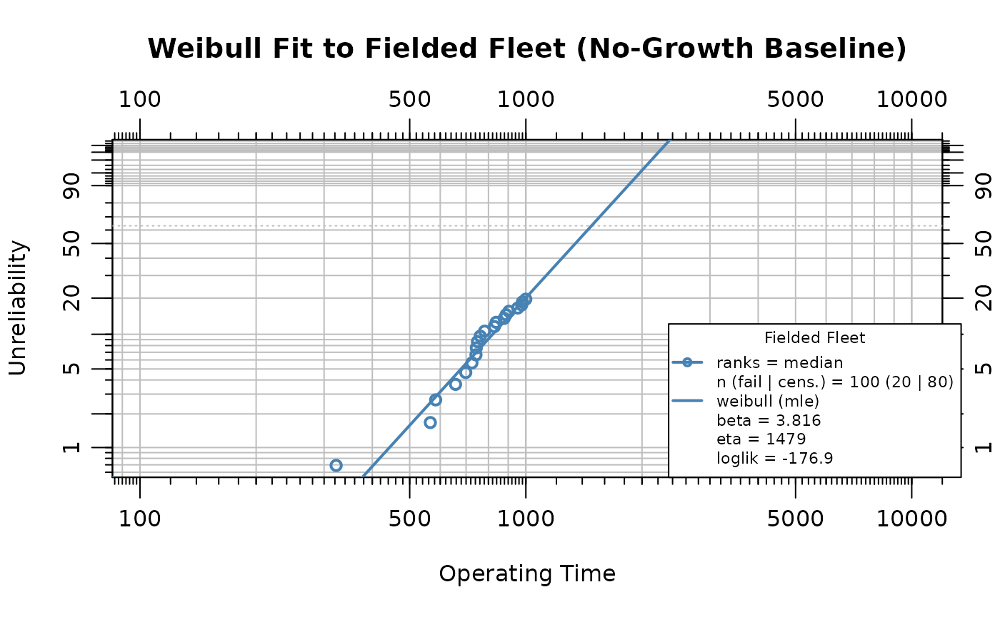
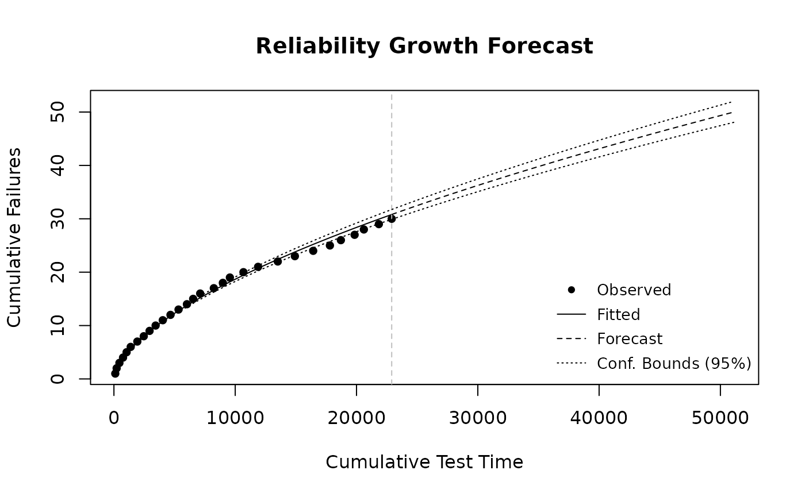
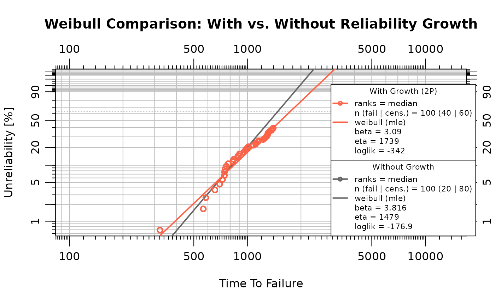
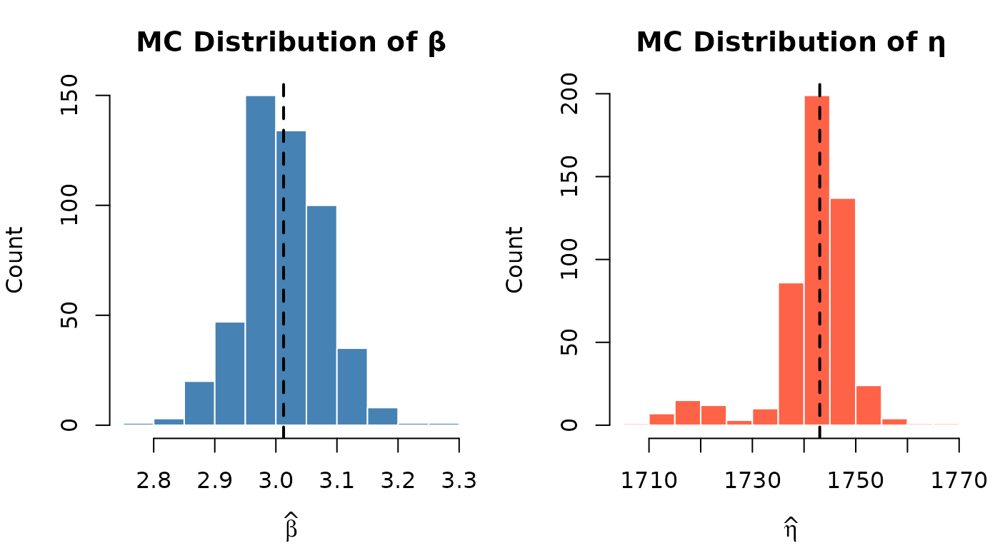
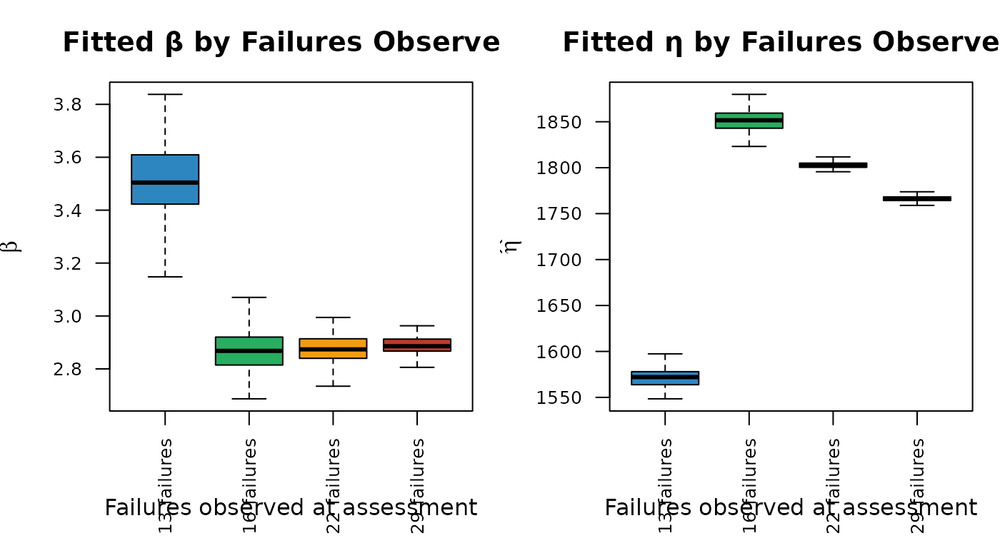

# Reliability Growth Forecasting

``` r

library(ReliaGrowR)
library(WeibullR)
```

## Introduction

Reliability Growth Analysis (RGA) tracks the improvement of system
reliability over a development program as design changes are introduced.
However, translating an observed growth trend into a fleet-level life
forecast requires several additional steps that are often performed
separately, leading to potential inconsistencies, loss of fidelity in
reliability projections, and an incomplete picture of future system
performance. This vignette presents an integrated workflow that connects
RGA to life estimation through stochastic simulation, propagating an
observed reliability growth trend into a fleet-level life distribution.

The example is structured in two phases, both involving non-repairable
units. In the **fielded fleet** (Phase 1), a population of the matured
design is placed in service and a Weibull distribution is fitted to
characterize the unit-level failure behavior, providing the no-growth
baseline. In the **developmental growth test** (Phase 2), prototypes are
built and tested to failure in sequence; design improvements introduced
between builds genuinely increase unit life, so the Crow-AMSAA growth
parameter $`\beta_{\text{growth}} < 1`$ reflects a real improvement
trend. The growth trend established in development is then projected
forward to forecast the fleet’s life distribution. Over a fixed forecast
window the growth model lowers the number of additional failures
expected from the fleet’s own life distribution,
[`sim_failures()`](https://paulgovan.github.io/ReliaGrowR/reference/sim_failures.md)
generates conditional failure times for the surviving units over that
window, and the simulated failures are combined with observed data to
fit a growth-adjusted Weibull distribution. Monte Carlo analysis
quantifies the variability introduced by the simulation, and sensitivity
analyses examine how the results depend on the fleet assessment point
and the strength of the growth trend.

## Fielded Fleet and Life Data Analysis

A fleet of 100 units of the matured design is placed into service, each
observed over a 1000 time-unit period. These are non-repairable units:
each either fails once or is right-censored (suspended) at the end of
the observation window. To provide a reproducible example, the fleet
life data are simulated from the matured Weibull population (shape 4,
scale 1456).

``` r

set.seed(8)
n_units <- 100
test_end <- 1000
beta_mech <- 4 # wear-out failure mechanism (shape), constant across builds
eta_matured <- 1456 # characteristic life of the final, matured design
fleet_life <- eta_matured * (-log(runif(n_units)))^(1 / beta_mech)

failures <- sort(fleet_life[fleet_life <= test_end])
suspensions <- rep(test_end, sum(fleet_life > test_end))

n_test_failures <- length(failures)
n_surviving <- length(suspensions)
```

This draw yields 20 exact failures, leaving 80 surviving units at risk
during the forecast period. The `WeibullR` package fits a Weibull
distribution to the fielded data, providing the no-growth baseline life
distribution:

``` r

obj <- wblr(failures, suspensions,
  col = "steelblue", label = "Fielded Fleet", is.plot.cb = FALSE
)
obj <- wblr.fit(obj, method.fit = "mle")
sim_beta <- obj$fit[[1]]$beta
eta_orig <- obj$fit[[1]]$eta
plot(obj,
  main = "Weibull Fit to Fielded Fleet (No-Growth Baseline)",
  xlab = "Operating Time", ylab = "Unreliability"
)
```



The estimated shape parameter $`\beta`$ is 3.816 and the scale parameter
$`\eta`$ is 1479.4. A shape parameter greater than one confirms the
wear-out failure mode. This Weibull $`\beta`$ describes the unit-level
hazard in *individual age* and is distinct from the Crow-AMSAA
$`\beta_{\text{growth}}`$, which describes the system-level
failure-intensity trend over the development program.

## Developmental Growth Test

In a developmental reliability growth program, prototype units are built
and tested to failure one at a time. After each failure the design is
analyzed and improved, so successive builds are progressively more
reliable. We represent this by simulating 30 sequential builds in which
the characteristic life $`\eta`$ of the underlying wear-out mechanism
increases with build index, while the shape (failure mechanism) is held
fixed.

``` r

set.seed(3)
N_dev <- 30 # prototypes built and tested in sequence
g_exp <- 0.8 # strength of design-life improvement with build index

# Design life improves with build index; the last build is the matured design.
eta_build <- eta_matured * (seq_len(N_dev) / N_dev)^g_exp
dev_life <- eta_build * (-log(runif(N_dev)))^(1 / beta_mech)
dev_cum <- cumsum(dev_life)
```

The Crow-AMSAA model is fitted directly with
[`rga()`](https://paulgovan.github.io/ReliaGrowR/reference/rga.md),
treating each build as one failure at its cumulative test time. The
cumulative failure function is
$`N(t) = \lambda\, t^{\beta_{\text{growth}}}`$, where
$`\beta_{\text{growth}} < 1`$ indicates a decreasing failure intensity —
genuine reliability growth.

``` r

dev_fit <- rga(
  data.frame(times = dev_cum, failures = rep(1, N_dev)),
  times_type = "cumulative_failure_times"
)
growth_beta <- as.numeric(dev_fit$betas)
dev_r2 <- summary(dev_fit$model)$r.squared

plot(dev_fit,
  main = "Developmental Reliability Growth Test",
  xlab = "Cumulative Test Time", ylab = "Cumulative Failures"
)
```


The fitted growth parameter is $`\beta_{\text{growth}}`$ = 0.603
($`R^2`$ = 0.996), indicating a decreasing failure intensity as the
design matured. The reliability growth rate is
$`g = 1 - \beta_{\text{growth}}`$ = 0.397.

## Reliability Growth Forecast

The growth trend established in development is now projected onto the
fielded fleet. The forecast is run over a fixed **forecast window**
taken from the life data; over that window the fitted fleet Weibull sets
the number of failures expected with no growth, and the developmental
growth rate $`\beta_{\text{growth}}`$ lowers that count through the
Crow-AMSAA count-ratio.

The **no-growth count** is what the fitted fleet Weibull expects over
the window, read from each surviving unit’s *forward* hazard (age
$`r_i`$):

``` math
F_0 = \sum_i \left[1 - \exp\left\{-\left[\left(\tfrac{r_i + w}{\eta}\right)^{\beta} - \left(\tfrac{r_i}{\eta}\right)^{\beta}\right]\right\}\right]
```

Growth lowers this count. Re-anchoring the Crow-AMSAA scale to the fleet
($`\lambda = N_{\text{current}} / T_{\text{end}}^{\,\beta_{\text{growth}}}`$,
with $`T_{\text{end}}`$ the fleet’s cumulative operating time and
$`N_{\text{current}}`$ the failures observed so far), the expected
additional failures over the cumulative window $`\Delta t = n_s w`$ are
$`N_{\text{current}}[(1+\rho)^{\beta_{\text{growth}}} - 1]`$ with
$`\rho = \Delta t / T_{\text{end}}`$. Expressed as a ratio to the
no-growth case — which cancels the since-inception anchoring bias — the
**growth count-ratio** is

``` math
c(\beta_{\text{growth}}) = \frac{(1+\rho)^{\beta_{\text{growth}}} - 1}{\rho}, \qquad c(1) = 1,
```

and the growth-adjusted target count is
$`n = F_0 \, c(\beta_{\text{growth}})`$.

``` r

# Forecast window: a modest forward increment (~40% of the observation period) applied to
# each surviving unit, chosen rather than solved for.
forecast_window <- 400
test_end_cum_time <- sum(c(failures, suspensions))

# No-growth count the fitted fleet Weibull expects over the window (forward hazard).
expected_failures <- function(w, eta, r, beta) {
  sum(1 - exp(-(((r + w) / eta)^beta - (r / eta)^beta)))
}
# Scale that reproduces a target expected count over the window.
solve_eta <- function(target, r, beta, window) {
  uniroot(function(eta) expected_failures(window, eta, r, beta) - target,
    interval = c(1e-3, 1e9)
  )$root
}
# Crow-AMSAA growth count-ratio: growth lowers the expected count; equals 1 at beta_growth = 1.
count_ratio <- function(bg, rho) ((1 + rho)^bg - 1) / rho

f0 <- expected_failures(forecast_window, eta_orig, rep(test_end, n_surviving), sim_beta)
rho <- (n_surviving * forecast_window) / test_end_cum_time
n_expected <- f0 * count_ratio(growth_beta, rho)
n_forecast <- round(n_expected)
n_target <- n_test_failures + n_forecast
```

Over the forecast window of $`w`$ = 400 operating time units, the fitted
fleet Weibull expects $`F_0`$ = 35.5 failures with no growth. The growth
count-ratio is $`c`$ = 0.57, lowering the growth-adjusted target to
$`n`$ = 20 additional failures, for a total of 40 cumulative failures.
Because $`c = 1`$ at $`\beta_{\text{growth}} = 1`$, with no growth the
target reduces to $`F_0`$ and the calibrated scale returns the fitted
fleet value, so the growth-adjusted distribution then recovers the
no-growth baseline exactly.

Underlying the fleet projection is the developmental growth model
itself, which
[`predict_rga()`](https://paulgovan.github.io/ReliaGrowR/reference/predict_rga.md)
extrapolates to forecast continued failure accumulation. The figure
shows the Crow-AMSAA model fitted to the 30 developmental builds and
forecast forward to 50 cumulative failures (i.e. 20 further failures
along the same trend), with the model’s confidence bounds.

``` r

dev_target <- N_dev + n_forecast
t_f_dev <- (dev_target / as.numeric(dev_fit$lambdas))^(1 / growth_beta)
dev_forecast_times <- seq(max(dev_cum) * 1.001, t_f_dev, length.out = 50)

fc <- predict_rga(dev_fit, times = dev_forecast_times)
plot(fc,
  main = "Reliability Growth Forecast",
  xlab = "Cumulative Test Time", ylab = "Cumulative Failures"
)
```



## Simulating Failures

The
[`sim_failures()`](https://paulgovan.github.io/ReliaGrowR/reference/sim_failures.md)
function generates conditional Weibull failure times for the surviving
units. Each unit has already accumulated 1000 operating time units, and
the simulation draws failure times from the conditional Weibull
distribution over the forecast window. We calibrate the Weibull scale
parameter $`\eta`$ to the growth-adjusted expected count over the window
and pass it in (at $`\beta_{\text{growth}} = 1`$ this returns the fitted
fleet scale exactly), then draw the integer number of failures.

``` r

set.seed(123)
sim_eta <- solve_eta(n_expected, rep(test_end, n_surviving), sim_beta, forecast_window)
sim_result <- sim_failures(
  n = n_forecast,
  runtimes = rep(1000, n_surviving),
  window = forecast_window,
  beta = sim_beta,
  eta = sim_eta
)
```

The calibrated scale parameter is $`\eta`$ = 1778.1, compared to the
original baseline estimate of $`\eta`$ = 1479.4. The increase in
$`\eta`$ is the mechanical consequence of the assumed growth: growth
lowers the expected failure count over the fixed window, so a larger
characteristic life is required to reproduce the reduced count. Of the
80 surviving units, 20 receive simulated failure times and 60 are
right-censored at the end of the forecast window.

The simulated failures are combined with the 20 observed failures:

``` r

sim_fail_times <- sim_result$runtime[sim_result$type == "Failure"]
sim_susp_times <- sim_result$runtime[sim_result$type == "Suspension"]
combined_failures <- c(failures, sim_fail_times)
combined_suspensions <- sim_susp_times
```

## Weibull Comparison

Two Weibull models are fitted to contrast the effect of reliability
growth:

- **Without growth**: fitted to the fielded fleet data (20 failures, 80
  suspensions at $`t = 1000`$). This represents the life distribution
  implied by the fleet alone, without projecting the growth trend
  forward.
- **With growth**: fitted to the combined dataset (20 observed
  failures + 20 simulated failures + 60 suspensions). This represents
  the life distribution when growth-adjusted failure times are included.

``` r

# Headline comparison is like-for-like: a 2-parameter Weibull fitted by MLE to both the
# fielded fleet (no-growth baseline) and the growth-augmented data, so the two fits differ
# only in their data, not in parameterization or estimation method.
obj_nogrowth <- wblr(failures, suspensions,
  col = "grey40", label = "Without Growth", is.plot.cb = FALSE
)
obj_nogrowth <- wblr.fit(obj_nogrowth, method.fit = "mle")

obj_growth <- wblr(combined_failures, combined_suspensions,
  col = "tomato", label = "With Growth (2P)", is.plot.cb = FALSE
)
obj_growth <- wblr.fit(obj_growth, method.fit = "mle")

plot.wblr(list(obj_nogrowth, obj_growth),
  main = "Weibull Comparison: With vs. Without Reliability Growth",
  is.plot.legend = TRUE
)
```



``` r

growth_wb_beta <- obj_growth$fit[[1]]$beta
growth_wb_eta <- obj_growth$fit[[1]]$eta
nogrowth_wb_beta <- obj_nogrowth$fit[[1]]$beta
nogrowth_wb_eta <- obj_nogrowth$fit[[1]]$eta

# B10 life (10th-percentile life): t such that F(t) = 0.10.
b10 <- function(beta, eta, t0 = 0) t0 + eta * (-log(0.90))^(1 / beta)
nogrowth_b10 <- b10(nogrowth_wb_beta, nogrowth_wb_eta)
growth_b10 <- b10(growth_wb_beta, growth_wb_eta)

params <- data.frame(
  Scenario = c("Without Growth (2P)", "With Growth (2P)"),
  Beta = round(c(nogrowth_wb_beta, growth_wb_beta), 3),
  Eta = round(c(nogrowth_wb_eta, growth_wb_eta), 1),
  B10 = round(c(nogrowth_b10, growth_b10), 1)
)

knitr::kable(params,
  caption = "Weibull parameters and B10 life: with vs. without reliability growth (two-parameter MLE)",
  col.names = c("Scenario", "β", "η", "B10"),
  row.names = FALSE
)
```

| Scenario            |     β |      η |   B10 |
|:--------------------|------:|-------:|------:|
| Without Growth (2P) | 3.816 | 1479.4 | 820.3 |
| With Growth (2P)    | 3.090 | 1739.0 | 839.5 |

Weibull parameters and B10 life: with vs. without reliability growth
(two-parameter MLE) {.table}

Under the assumed continued growth, the fleet accumulates fewer failures
over the forecast window than its no-growth life distribution predicts,
producing a larger estimated $`\eta`$ (rightward shift in the life
distribution). This shift is a mechanistic consequence of calibrating
the simulation to the growth-reduced failure count rather than an
independently discovered effect; the analysis quantifies its size, it
does not establish its existence.

To keep the comparison like-for-like, both the no-growth baseline and
the growth-augmented data are fitted with a two-parameter Weibull by
maximum likelihood, so the two fits differ only in their data — not in
parameterization or estimation method. The B10 life — the
10th-percentile life, $`\eta\,(-\ln 0.9)^{1/\beta}`$ — is the headline
growth indicator, rising from 820.3 (without growth) to 839.5 (with
growth).

## Monte Carlo Analysis

A single call to
[`sim_failures()`](https://paulgovan.github.io/ReliaGrowR/reference/sim_failures.md)
produces one realization of the 20 simulated failure times. Different
random draws yield different combined datasets and therefore different
Weibull parameter estimates. The Monte Carlo analysis repeats the
procedure 500 times to characterize this variability. Two sources are
propagated: the randomness of the conditional simulation and the
estimation uncertainty in the developmental growth parameter
$`\beta_{\text{growth}}`$. The result should be read as a forecast
variability band rather than a formal confidence interval.

### Run the Monte Carlo Loop

Each iteration resamples the growth parameter from its sampling
distribution, recomputes the growth-adjusted failure count over the
fixed window, then draws a new set of simulated failure times, combines
them with the 20 observed failures, and fits a Weibull distribution.

``` r

set.seed(99)
n_mc <- 500
mc_results <- vector("list", n_mc)

# Sampling distribution of the developmental growth parameter.
betag_hat <- as.numeric(dev_fit$betas)
betag_se <- as.numeric(dev_fit$betas_se)

for (i in seq_len(n_mc)) {
  tryCatch(
    {
      # Draw a growth parameter and recompute the growth-adjusted count over the window.
      beta_i <- rnorm(1, betag_hat, betag_se)
      if (beta_i <= 0) stop("non-positive growth parameter draw")
      target_i <- f0 * count_ratio(beta_i, rho)
      if (!is.finite(target_i) || target_i <= 0) stop("non-positive count draw")

      mc_results[[i]] <- sim_and_fit(
        failures, target_i, rep(1000, n_surviving), forecast_window, sim_beta
      )
    },
    error = function(e) NULL
  )
}

mc_df <- do.call(rbind, Filter(Negate(is.null), mc_results))
```

### Visualize the Parameter Distributions

Histograms of the fitted $`\hat{\beta}`$ and $`\hat{\eta}`$ across all
valid iterations show the spread introduced by the combined
growth-parameter and simulation variability. The dashed line marks the
Monte Carlo median, and the dotted grey line marks the no-growth
baseline.

``` r

par(mfrow = c(1, 2), mar = c(4, 4, 3, 1))

hist(mc_df$beta,
  breaks = "Sturges", col = "steelblue", border = "white",
  main = "MC Distribution of β",
  xlab = expression(hat(beta)), ylab = "Count", freq = TRUE
)
abline(v = median(mc_df$beta), lty = 2, lwd = 2)
abline(v = nogrowth_wb_beta, lty = 3, lwd = 2, col = "grey40")

hist(mc_df$eta,
  breaks = "Sturges", col = "tomato", border = "white",
  main = "MC Distribution of η",
  xlab = expression(hat(eta)), ylab = "Count", freq = TRUE
)
abline(v = median(mc_df$eta), lty = 2, lwd = 2)
abline(v = nogrowth_wb_eta, lty = 3, lwd = 2, col = "grey40")
```



``` r


par(mfrow = c(1, 1))
```

### Monte Carlo Summary

``` r

mc_df$b10 <- b10(mc_df$beta, mc_df$eta)

mc_summary <- data.frame(
  Parameter = c("β", "η", "B10"),
  NoGrowth = round(c(nogrowth_wb_beta, nogrowth_wb_eta, nogrowth_b10), 3),
  Median = round(c(median(mc_df$beta), median(mc_df$eta), median(mc_df$b10)), 3),
  Mean = round(c(mean(mc_df$beta), mean(mc_df$eta), mean(mc_df$b10)), 3),
  CI_lo = round(c(
    quantile(mc_df$beta, 0.025),
    quantile(mc_df$eta, 0.025),
    quantile(mc_df$b10, 0.025)
  ), 3),
  CI_hi = round(c(
    quantile(mc_df$beta, 0.975),
    quantile(mc_df$eta, 0.975),
    quantile(mc_df$b10, 0.975)
  ), 3)
)

knitr::kable(mc_summary,
  caption = paste0(
    "Monte Carlo summary of Weibull parameters and B10 life (",
    nrow(mc_df), " valid iterations)"
  ),
  col.names = c(
    "Parameter", "No Growth", "Median", "Mean", "2.5%", "97.5%"
  ),
  row.names = FALSE
)
```

| Parameter | No Growth |   Median |     Mean |     2.5% |    97.5% |
|:----------|----------:|---------:|---------:|---------:|---------:|
| β         |     3.816 |    3.013 |    3.014 |    2.880 |    3.140 |
| η         |  1479.424 | 1743.035 | 1741.683 | 1716.308 | 1753.066 |
| B10       |   820.290 |  825.069 |  825.230 |  801.951 |  846.482 |

Monte Carlo summary of Weibull parameters and B10 life (500 valid
iterations) {.table}

The Monte Carlo distributions quantify how much the growth-adjusted
Weibull estimates vary across repeated simulations, here almost entirely
from the stochastic simulation rather than from growth-parameter
estimation uncertainty. These bands represent the variability of the
forecast conditional on the fitted growth model and the assumed growth
continuation, not inferential confidence intervals.

## Sensitivity Analysis

The preceding Monte Carlo analysis held the fleet assessment fixed while
resampling the growth parameter and the simulated failure draws. This
section examines how two key inputs affect the growth-adjusted Weibull:
(a) the fleet assessment point — how many failures have been observed
when the forecast is made — and (b) the Crow-AMSAA growth parameter.

### Effect of Fleet Assessment Point

The point at which the fleet is assessed determines how many failures
have been observed and how much operating time has accrued, which
together set the re-anchored $`\lambda`$ and the length of the
extrapolation. The same fleet is assessed at four service points,
yielding progressively more observed failures.

``` r

assessment_times <- c(850, 950, 1050, 1150)
fleet_obs <- vapply(assessment_times, function(te) sum(fleet_life <= te), integer(1))
fleet_labels <- paste0(fleet_obs, " failures")
```

``` r

set.seed(42)
n_mc_sens <- 200

sens_fail_list <- lapply(seq_along(assessment_times), function(k) {
  te <- assessment_times[k]
  fail_te <- sort(fleet_life[fleet_life <= te])
  susp_te <- rep(te, sum(fleet_life > te))
  n_obs <- length(fail_te)
  n_surv <- length(susp_te)

  obj_te <- wblr.fit(wblr(fail_te, susp_te, is.plot.cb = FALSE), method.fit = "mle")
  beta_te <- obj_te$fit[[1]]$beta
  eta_te <- obj_te$fit[[1]]$eta

  if (n_surv <= 0) {
    return(NULL)
  }
  # No-growth count over the fixed window from this assessment's own fitted baseline,
  # lowered by the growth count-ratio at this assessment's cumulative exposure.
  f0_te <- expected_failures(forecast_window, eta_te, rep(te, n_surv), beta_te)
  rho_te <- (n_surv * forecast_window) / sum(c(fail_te, susp_te))
  target_te <- f0_te * count_ratio(growth_beta, rho_te)
  if (!is.finite(target_te) || target_te <= 0) {
    return(NULL)
  }

  rows <- lapply(seq_len(n_mc_sens), function(i) {
    tryCatch(
      {
        r <- sim_and_fit(fail_te, target_te, rep(te, n_surv), forecast_window, beta_te)
        cbind(scenario = fleet_labels[k], r)
      },
      error = function(e) NULL
    )
  })
  do.call(rbind, Filter(Negate(is.null), rows))
})

sens_fail_df <- do.call(rbind, Filter(Negate(is.null), sens_fail_list))
sens_fail_df$scenario <- factor(sens_fail_df$scenario, levels = fleet_labels)
```

``` r

par(mfrow = c(1, 2), mar = c(5, 4, 3, 1))

fail_cols <- c("#2E86C1", "#27AE60", "#F39C12", "#C0392B")
boxplot(beta ~ scenario,
  data = sens_fail_df,
  col = fail_cols, outline = FALSE,
  main = "Fitted β by Failures Observed",
  xlab = "Failures observed at assessment", ylab = expression(hat(beta)),
  las = 2, cex.axis = 0.8
)

boxplot(eta ~ scenario,
  data = sens_fail_df,
  col = fail_cols, outline = FALSE,
  main = "Fitted η by Failures Observed",
  xlab = "Failures observed at assessment", ylab = expression(hat(eta)),
  las = 2, cex.axis = 0.8
)
```



``` r


par(mfrow = c(1, 1))
```

Across the four assessment points the growth count-ratio is essentially
constant ($`c \approx 0.8`$), so the growth adjustment itself is robust
to when the fleet is assessed; the visible variation is inherited from
the *baseline* Weibull fit, which is depressed by the heavy censoring of
an early assessment (few observed failures) and stabilizes once enough
failures have accrued. A dependable growth forecast therefore depends
less on the assessment timing than on having enough observed failures to
pin down the fleet’s baseline life distribution.

### Effect of Growth Parameter

The Crow-AMSAA growth parameter $`\beta_{\text{growth}}`$ controls the
growth count-ratio $`c(\beta_{\text{growth}})`$: stronger growth
(smaller $`\beta_{\text{growth}}`$) lowers the expected failure count
over the fixed window, producing fewer simulated failures and a larger
$`\eta`$. Four growth scenarios are examined while holding all other
inputs at their base values; each scales the same no-growth count
$`F_0`$ by its ratio $`c(\beta_{\text{growth}})`$, so the scenarios
differ only in the growth strength.

``` r

growth_scenarios <- c(0.4, 0.6, 0.8, 1.0)
growth_labels <- c(
  "βg = 0.4 (strong)",
  "βg = 0.6 (moderate)",
  "βg = 0.8 (mild)",
  "βg = 1.0 (none)"
)
```

``` r

set.seed(77)

sens_growth_list <- lapply(seq_along(growth_scenarios), function(k) {
  gb <- growth_scenarios[k]

  # Lower the fixed-window no-growth count by the growth ratio for this scenario.
  target_k <- f0 * count_ratio(gb, rho)

  if (target_k <= 0) {
    return(NULL)
  }

  rows <- lapply(seq_len(n_mc_sens), function(i) {
    tryCatch(
      {
        r <- sim_and_fit(
          failures, target_k, rep(1000, n_surviving), forecast_window, sim_beta
        )
        cbind(scenario = growth_labels[k], r)
      },
      error = function(e) NULL
    )
  })
  do.call(rbind, Filter(Negate(is.null), rows))
})

sens_growth_df <- do.call(rbind, Filter(Negate(is.null), sens_growth_list))
sens_growth_df$scenario <- factor(sens_growth_df$scenario, levels = growth_labels)
```

``` r

par(mfrow = c(1, 2), mar = c(5, 4, 3, 1))

growth_cols <- c("#2E86C1", "#27AE60", "#F39C12", "#C0392B")
boxplot(beta ~ scenario,
  data = sens_growth_df,
  col = growth_cols, outline = FALSE,
  main = "Fitted β by Growth Strength",
  xlab = "Growth scenario", ylab = expression(hat(beta)),
  las = 2, cex.axis = 0.75
)

boxplot(eta ~ scenario,
  data = sens_growth_df,
  col = growth_cols, outline = FALSE,
  main = "Fitted η by Growth Strength",
  xlab = "Growth scenario", ylab = expression(hat(eta)),
  las = 2, cex.axis = 0.75
)
```


``` r


par(mfrow = c(1, 1))
```

Stronger reliability growth (smaller $`\beta_{\text{growth}}`$) lowers
the expected failure count over the fixed window through the count-ratio
$`c(\beta_{\text{growth}})`$, producing fewer simulated failures and a
larger fitted $`\eta`$ in the combined Weibull. At
$`\beta_{\text{growth}} = 1`$ (no growth), $`c(1) = 1`$ leaves the
target at the forward-correct no-growth count $`F_0`$, and the
growth-adjusted distribution recovers the no-growth baseline — its
median $`\eta`$ returns to the fitted fleet value up to Monte Carlo
noise.

## Limitations

1.  **Extrapolation uncertainty.** The reliability growth forecast
    extrapolates the developmental improvement trend beyond the test
    horizon and into service, so confidence in the forecast degrades
    with the length of the extrapolation. The simulation results should
    be interpreted as conditional on the growth trend continuing
    unchanged.

2.  **Model risk.** The Crow-AMSAA power-law model is one of several
    possible reliability growth models. Alternative models (e.g.,
    piecewise, AMSAA-Bingham) may yield different growth count-ratios
    and therefore different simulated life distributions.

3.  **Homogeneous fleet.** The simulation assumes all surviving units
    follow a single conditional Weibull distribution. If the fleet
    contains distinct subpopulations (e.g., different duty cycles or
    hardware revisions), separate analyses should be performed for each
    group.

4.  **Continued-growth assumption.** The forecast assumes the
    developmental growth trend continues to be reflected in field
    reliability. If the design is frozen at fielding and no further
    improvement occurs, the projection overstates the gain; the
    no-growth baseline then applies.

5.  **Repair policy.** The simulation assumes failed units are not
    replaced. The combined dataset treats all simulated failures as
    first-failure events for each unit.

6.  **Remaining uncertainty sources.** The Monte Carlo analysis
    propagates estimation uncertainty in the growth parameter
    $`\beta_{\text{growth}}`$, but model-form uncertainty and the input
    Weibull shape parameter remain unrepresented. Reliability growth is
    treated as a scale effect that lengthens the characteristic life
    while leaving the failure-mode shape unchanged.

7.  **Mixture distribution.** The combined dataset is a mixture of
    fielded and post-growth failure populations, which produces downward
    curvature on the Weibull plot. The two-parameter B10 is retained
    because it is stable across estimation methods, though it may
    underestimate the true B10 of the growth-augmented distribution.

## Conclusion

This analysis demonstrated an end-to-end reliability growth forecasting
pipeline. A fielded fleet of the matured design was characterized by a
no-growth Weibull baseline. A developmental growth test of sequential
prototypes established a genuine reliability growth trend
($`\beta_{\text{growth}} < 1`$), which was then projected onto the
fleet. Over a fixed forecast window the Crow-AMSAA growth model lowered
the number of additional failures expected from the fleet’s own life
distribution, and
[`sim_failures()`](https://paulgovan.github.io/ReliaGrowR/reference/sim_failures.md)
generated conditional Weibull failure times for the surviving units over
that window. Combining the simulated failures with the observed fleet
data produced a growth-adjusted Weibull distribution, summarized by the
B10 life from a like-for-like two-parameter fit, that was compared
against the no-growth baseline. The upward shift relative to the
baseline is a mechanistic consequence of the growth-reduced failure
count over the window; the Monte Carlo analysis quantified its
variability, and sensitivity analyses showed how the results depend on
the fleet assessment point and the strength of the growth trend.
Together, these components provide a repeatable methodology for
translating an observed reliability growth trend into fleet-level life
distribution estimates, with the forecast understood as conditional on
that trend continuing into service.
